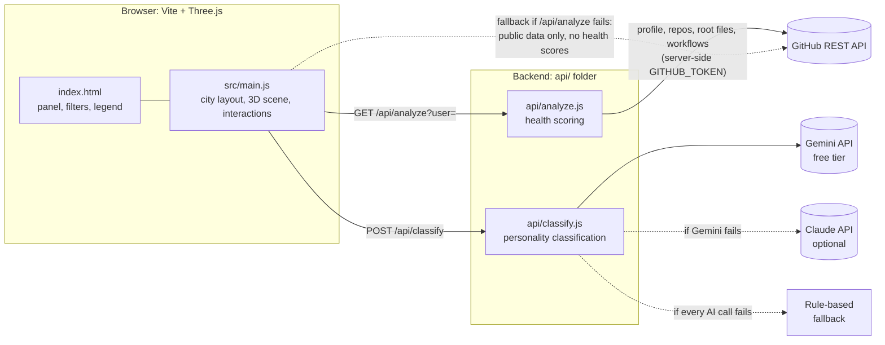
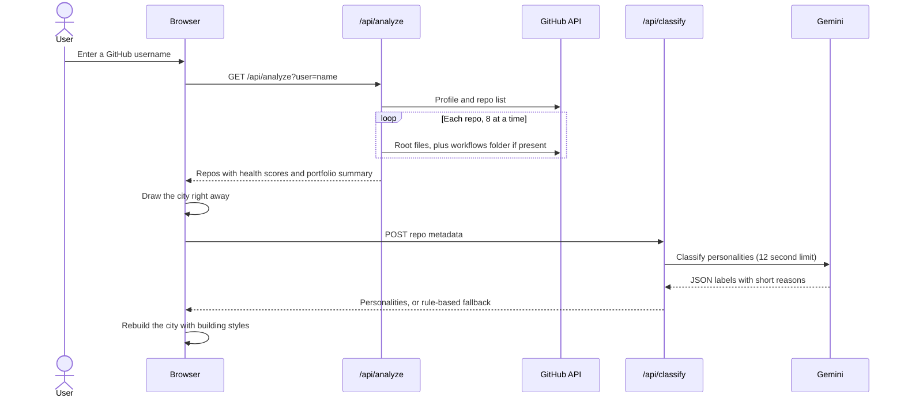
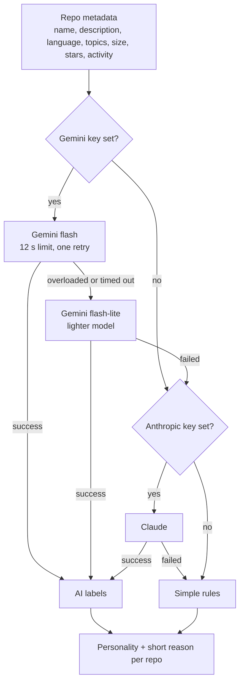

<div align="center">

# 🏙️ Repo City

**Turn any GitHub profile into a 3D city, and find out which projects need work.**

Every repo becomes a building. Every building gets a health score, a personality and a list of fixes.


</div>

---

## Why Repo City

A GitHub profile is a grid of green squares and a list of repo names. It tells a recruiter almost nothing about how someone works, and it tells the developer nothing about what to fix.

Repo City turns a profile into something you can read at a glance, and then goes one step further:

| If you are... | Repo City helps you... |
|---|---|
| **A developer** | See what is missing across your repos (no tests, no README, no demo) and which single fix is worth the most points, before you send your profile to anyone. |
| **A recruiter or hiring manager** | Open a candidate's profile and immediately see the three projects worth looking at first, instead of scrolling through 40 repos. |
| **A mentor or bootcamp instructor** | Spot the gaps that are common across a student's work and give concrete, specific feedback. |

---

## Features

- **3D city from real data.** One building per original repo (forks are skipped), grouped into districts by language.
- **Health score (0-100) per repo.** Ten checks covering README, description, topics, license, live demo, tests, CI, activity and substance. Every miss turns into a concrete tip and a "biggest win" callout.
- **Portfolio summary.** An overall score and grade, plus the biggest gaps across all repos, such as "39 of 40 repos have no tests".
- **"Start here" top 3.** The projects a recruiter should open first, marked with floating gold diamonds in the city.
- **AI personality classification.** Each repo is labeled *production*, *experimental*, *learning*, *abandoned* or *utility* and drawn in a matching architectural style. Uses the Gemini free tier, with Claude and simple rules as fallbacks.
- **Search and filters.** Filter by name, language, type and grade. Non-matching buildings fade out on the map.
- **Color by Language or Health.** Switch the whole city between language colors and health-grade colors (green to red) to spot weak areas instantly.
- **Interactive.** Hover for details, click a building or a list item for the full report, and the camera flies to the selected repo.

---

### Architecture

The browser draws the city. A small backend in `api/` talks to GitHub and the AI provider, so no API key ever reaches the browser.



During development, `vite.config.js` serves each file in `api/` at `/api/<name>` and loads your keys from `.env`. The files use the standard `(req, res)` handler shape, so they can also run as serverless functions on a platform like Vercel.

### What happens when you search



The city appears as soon as the health scan finishes. AI classification runs in the background, so the page never waits on it.

### From repo data to city

| GitHub data | City element |
|---|---|
| Repo | Building |
| Repo size | Height (log scale, so huge repos don't dwarf everything) |
| Stars | Width |
| Primary language | District tile and building color |
| Pushed in the last 90 days | Glowing building |
| Personality (AI or rules) | Architectural style |
| Health grade | Building color, in Health mode |
| Top health and traction | Gold diamond marker ("Start here") |

Districts are placed with a simple **shelf-packing layout**: districts are sorted by size, laid out left to right, and wrapped to a new row when the row is full. Inside each district, buildings sit on a grid.

**Architectural styles by personality**

| Personality | Building |
|---|---|
| 🏢 Production | Tall glossy tower with a crown and antenna |
| 🧪 Experimental | Off-kilter, tilted tower with a twisted top block |
| 📚 Learning | Small house with a pyramid roof |
| 🏚️ Abandoned | Faded, dark, leaning, with rubble beside it |
| 🔧 Utility | Wide, low factory with a chimney |

### The health score

Each repo is scored out of 100 from its public files and metadata.

| Check | Points | What is looked for |
|---|---|---|
| README | 15 | A README file in the repo root |
| README detail | 10 | Enough content to be useful (partial credit for short ones) |
| Description | 10 | A one-line description in the About box |
| Topics | 5 | Two or more topics |
| License | 5 | A license is set |
| Live demo | 10 | A homepage link or GitHub Pages |
| Tests | 10 | A tests folder or test config at the repo root |
| CI | 10 | A GitHub Actions workflow (or another CI config) |
| Recent activity | 15 | Pushed within 90 days (partial credit up to a year) |
| Substance | 10 | The repo has real content (by size) |

**Grades:** A is 85 or more, B is 70 or more, C is 50 or more, D is below 50.

The portfolio view also shows the **biggest gaps** (the checks that cost the most points across all repos) and a **"Start here" top 3**, ranked by health score plus a small bonus for stars, excluding archived repos.

### AI classification and fallbacks



The app never breaks because of the AI. If every provider fails, a simple rule-based classifier fills in, and the status bar tells you which one was used.

---

## Tech stack

| Layer | Technology |
|---|---|
| 3D rendering | [Three.js](https://threejs.org/) (scene, raycasting, camera animation) |
| Build tool and dev server | [Vite](https://vitejs.dev/), with a small plugin that runs `api/` locally |
| Frontend | Vanilla JavaScript, HTML and CSS (no framework) |
| Backend | Node.js handlers in `api/`, serverless-style |
| Data | GitHub REST API |
| AI | Google Gemini API (free tier), Anthropic Claude (optional), rule-based fallback |

---

## Getting started

### Prerequisites

- Node.js 20.19 or newer (the current LTS is a good choice)
- A free GitHub token (see below)
- Optional: a free Gemini API key for AI classification

### Install

```bash
git clone https://github.com/Nishupathak/repo-city.git
cd repo-city
npm install
```
```bash
GITHUB_TOKEN=your-github-token
GEMINI_API_KEY=your-gemini-key
```

| Variable | Required | How to get it |
|---|---|---|
| `GITHUB_TOKEN` | Yes, for health scans | Go to [github.com/settings/personal-access-tokens/new](https://github.com/settings/personal-access-tokens/new) and create a **fine-grained token** with **Public repositories (read-only)** and no other permissions. This raises GitHub's limit from 60 to 5,000 requests per hour. |
| `GEMINI_API_KEY` | Yes | Get a free key at [aistudio.google.com](https://aistudio.google.com) ("Get API key"). No credit card needed. |
| `ANTHROPIC_API_KEY` | No | From [console.anthropic.com](https://console.anthropic.com). Only used if Gemini is missing or fails. |

### Run

```bash
npm run dev
```

Open the local URL it prints (usually `http://localhost:5173`) and type a GitHub username. `.env` is only read at startup, so restart the server after changing it.

### Troubleshooting

| What you see | What it means |
|---|---|
| "Health scan unavailable: GITHUB_TOKEN is not set" | The `.env` file is missing, misplaced, or the server was not restarted. It must sit next to `package.json`. |
| "Health scan unavailable: GitHub rejected the token" | The token was copied wrong or has expired. Create a new one. |
| "GitHub rate limit reached" | Too many scans in a short time. Wait a while, or check that the token is set. |
| "classified by simple rules (gemini unavailable)" | Gemini was busy, slow or the key is invalid. The terminal prints the exact reason on a `[classify]` line. The app still works using the fallback. |
| "classified by simple rules" (no brackets) | No AI key is configured. This is normal if you skipped the optional keys. |

---

## Project structure

```
repo-city/
├── api/
│   ├── analyze.js        # scans a profile and scores each repo's health
│   └── classify.js       # classifies repo personalities (Gemini, Claude, rules)
├── src/
│   └── main.js           # Three.js scene, city layout, side panel, filters
├── docs/
│   └── screenshots/      # images used in this README
├── index.html            # page structure and styles
├── vite.config.js        # runs the files in api/ locally and loads .env
├── .env.example          # template for your keys
├── LICENSE
└── README.md
```

---

## Design decisions and challenges

**Keys stay on the server.** The browser never sees the GitHub token or any AI key. It only calls `/api/analyze` and `/api/classify`, and the handlers in `api/` hold the secrets.

**Rules first, AI second.** The health score is pure rule-based logic, so it is free, instant and never fails. AI is used only for personality labels, where judgment helps, and every failure path falls back gracefully.

**Surviving flaky AI APIs.** Free-tier APIs get overloaded. The Gemini call has a per-attempt time limit, one retry for temporary errors, a switch to a lighter model, and a hard 25 second ceiling. Before the time limits existed, a stalled request froze the whole page, which is why the city is now drawn first and classification runs in the background.

**Staying inside GitHub's rate limits.** Scanning 40 repos means about 40 to 80 API requests. The backend uses a token (5,000 requests per hour), limits itself to 8 requests at a time, and caches each result for 10 minutes. If the scan fails, the browser falls back to public data so the city still appears.

**Treating GitHub text as untrusted.** Repo names and descriptions are written by strangers. The side panel and tooltips build their content with `textContent` instead of HTML, the AI prompt tells the model to treat repo text as data and never as instructions, and usernames are validated before use.

**Fitting very different profiles on one map.** Some users have 3 repos, others 40 across 10 languages. The shelf-packing layout sizes each district to its contents, and the camera, fog and shadow area adjust to the size of the city.

---

## Limitations

- Scores are rule-based checks of public files. They show what is **missing**, not how good the code is.
- Tests are only detected at the repository root, so a repo with tests deeper in `src/` may be marked as missing them.
- Only the 40 most recently pushed original repos are shown. Private repos are not visible.
- Free-tier AI quotas are small. When they run out, classification falls back to rules.
- There is no hosted demo yet. The app runs locally.

<div align="center">

Built by [Nishu Pathak](https://github.com/Nishupathak)

</div>
